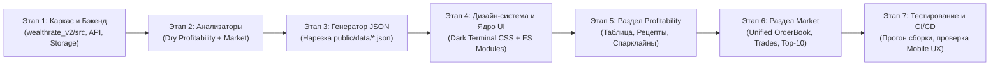

# Техническое Задание (ТЗ) и Архитектурный Проект: Wealthrate v2.0

---

## 1. Введение, Контекст и Цели Проекта

### 1.1. Предпосылки создания Wealthrate v2.0
1. **Глобальное обновление игры Warera**: В ближайшем патче игры механики регионов, бонусов стран/депозитов/этик, компаний и рабочих претерпят фундаментальные изменения. Единственный раздел, который остается неизменным на уровне API и игровой логики — **Market** («Рынок»), а также базовая рецептура крафта товаров (**Production Points & Ingredients**).
2. **Отказ от устаревающих модулей**:
   - Раздел **`Workers`** — удаляется полностью.
   - Раздел **`Company Basing`** — временно выводится из проекта (архитектура v2 закладывает модульный слот для его быстрого возвращения после изучения нового API компаний).
   - Из раздела **`Profitability`** полностью вырезаются зависимости от стран, регионов, налогов, депозитов, этик (`RegionBonusAnalyzer`) и бонусов `Fidelity`. Остается **кристально чистый («сухой») расчет стоимости 1 PP продукции относительно текущих рыночных цен покупки/продажи**.
3. **Решение критических проблем архитектуры v1**:
   - В первой версии весь фронтенд (`templates/index.html`) разросся до **7 911 строк** монолитного кода (HTML + CSS + JS в одном файле), что сделало поддержку, отладку и модификацию интерфейса крайне трудоемкими.
   - Кроме того, при каждой сборке все данные и многомесячные истории графиков запекались внутрь одного HTML-файла, заставляя мобильные браузеры скачивать и парсить весь объем данных за один раз.
4. **Новая продуктовая и визуальная концепция**:
   - Создание **абсолютно нового чистого проекта с нуля** в изолированной директории `d:\Programming\Python\WEwr\wealthrate_v2\` (без изменения файлов текущего проекта).
   - **Разделение на чистые модули и статические JSON (`Вариант Б`)**: верстка, стили и логика разбиты на небольшие независимые файлы (`public/css/*.css`, `public/js/*.js`), а данные генерируются Python-скриптом в отдельные легкие срезы `public/data/*.json` и подгружаются через `fetch()` по мере необходимости (с поддержкой обновления цифр на лету без перезагрузки страницы).
   - **Два ключевых раздела верхнего уровня**: **`Profitability`** и **`Market`** (внутри которого стаканы `Buy` и `Sell` объединены в единый биржевой **Order Book**, плюс подразделы **Trades** и **Leaderboards**).
   - **Дизайн-система**: строгий минималистичный **Dark Fintech Terminal** (вдохновленный эстетикой Linear, Raycast, Hyperliquid, TradingView) — только темная тема, идеальная табличная типографика (`tabular-nums`), высокий контраст и нулевой визуальный шум.
   - **Mobile-First UX**: основная аудитория заходит со смартфонов, поэтому все таблицы, объединенные стаканы ордеров, симуляторы и графики проектируются с приоритетом компактности и мгновенного отклика на экранах `360px–430px`.

---

## 2. Анализ Проблем v1 и Архитектурное Решение v2

### 2.1. Переход от монолита 7 900 строк к модульной архитектуре с подгрузкой JSON
| Проблема в Wealthrate v1 | Архитектурное решение в Wealthrate v2 | Выигрыш |
|---|---|---|
| Монолитный `templates/index.html` на **7 911 строк**, где смешаны CSS, HTML и JS всех разделов | **Модульный Vanilla JS (ES Modules) + компонентный CSS**: каждый раздел и компонент лежит в своем файле по 100–250 строк без необходимости пересборки HTML при правке стилей или скриптов | Идеальная читаемость кода, точные номера строк в DevTools (`F12`), готовность к расширению |
| Вшивание всех JSON-массивов внутрь HTML при каждой сборке | **Статические JSON-срезы в `public/data/*.json`**: браузер скачивает только JSON открытой вкладки (напр. `profitability.json` ~8 КБ), а остальное подгружает по клику | Молниеносная загрузка на мобильных устройствах и экономия трафика Vercel Free Tier |
| Перекачивание всего кода сайта каждые 20 минут при обновлении данных | **Кэширование статики + Live Refresh**: файлы `.css` и `.js` кэшируются браузером, а свежие `.json` можно подтягивать даже без перезагрузки страницы (кнопка `↻ Refresh`) | Обновление цифр в открытом стакане без сброса выбранных фильтров и открытых карточек |
| Одновременная инициализация всех тяжелых графиков Chart.js при старте | **Ленивая загрузка истории (`IntersectionObserver`)**: тяжелые файлы `*_history.json` скачиваются и рендерятся только тогда, когда пользователь доскроллил до графика | Мгновенный отклик интерфейса на смартфонах |

---

## 3. Структура Директорий Проекта (`wealthrate_v2/`)

Новый проект размещается в `d:\Programming\Python\WEwr\wealthrate_v2\` и полностью автономен:

```text
wealthrate_v2/
├── .github/
│   └── workflows/
│       ├── update_data.yml             # Основной крон (20 мин): сбор данных + нарезка public/data/*.json
│       └── cleanup_data_history.yml    # Ежемесячный squash старых коммитов в ветке data
├── docs/
│   ├── SPEC.md                         # Настоящее ТЗ
│   └── warera_api_endpoints.json       # Справочник tRPC эндпоинтов и тестовый ключ
├── scripts/
│   ├── bootstrap_known_players.py      # Первичное наполнение базы игроков
│   └── bootstrap_trades.py             # Первичная выгрузка сделок (Cold Start 7d)
├── src/
│   ├── __init__.py
│   ├── config.py                       # Константы, рецепты, PP, цвета, пути к файлам
│   ├── api_client.py                   # TRPCClient с батчингом (batch=1) и ротацией ключей
│   ├── entity_resolver.py              # Резолв и кэширование имен/аватарок (User, Country, MU, Party)
│   ├── storage.py                      # Чтение/запись сырых JSON-хранилищ и экспорт сжатых срезов в public/data/
│   └── analyzers/
│       ├── __init__.py
│       ├── profitability.py            # Сухой расчет 1 PP (Min/Max ₿/PP) и калькуляция рецептов
│       ├── orderbook.py                # Единый анализатор стаканов (Buy Depth + Sell Depth + Spread)
│       ├── trades.py                   # Инкрементальная дельта-синхронизация сделок + Volume Profile (POC)
│       └── leaderboards.py             # Агрегатор Топ-10 (Live Order Book + Trades за 24h/7d/30d/All)
├── public/                             # Готовая статика для Vercel (и локального превью)
│   ├── index.html                      # Легковесный HTML-каркас приложения (~15 КБ)
│   ├── favicon.webp
│   ├── assets/                         # Иконки товаров (.webp)
│   ├── css/
│   │   ├── variables.css               # Токены дизайн-системы (цвета, шрифты, отступы, радиусы)
│   │   ├── base.css                    # Сброс стилей, типографика, скроллбары, утилиты
│   │   ├── layout.css                  # Шапка, навигация, контейнеры, сетки, адаптив
│   │   └── components.css              # Таблицы, карточки стаканов, DOM-бары, бейджи, свитчеры
│   ├── js/
│   │   ├── app.js                      # Точка входа, роутинг по URL-хэшу (#profitability, #market/...)
│   │   ├── config.js                   # Фронтенд-константы и реестр вкладок (для будущего расширения)
│   │   ├── store.js                    # Реактивное состояние UI + кэш загруженных JSON-файлов
│   │   ├── utils/
│   │   │   ├── format.js               # Форматирование чисел (1.42M, 0.098 ₿, проценты, relative time)
│   │   │   └── dom.js                  # Хелперы рендеринга, дебаунс, IntersectionObserver
│   │   ├── components/
│   │   │   ├── sparkline.js            # Легковесный SVG/Canvas мини-график внутри карточки товара
│   │   │   ├── historyChart.js         # Общий компонент Chart.js (периоды, фильтры линий, ресайз)
│   │   │   └── entityBadge.js          # Унифицированный рендер игрока/страны/MU/партии с аватаром
│   │   └── views/
│   │       ├── profitabilityView.js    # Рендер раздела Profitability + калькулятор рецепта
│   │       ├── orderbookView.js        # Рендер объединенного стакана (Buy + Sell) и симуляторов
│   │       ├── tradesView.js           # Рендер раздела сделок, Volume Profile (POC) и ленты
│   │       └── leaderboardsView.js     # Рендер раздела Топ-10 с фильтрами и мульти-товарным дровером
│   └── data/                           # Автогенерируемые Python-скриптом сжатые JSON для фронтенда
│       ├── meta.json
│       ├── profitability.json
│       ├── profitability_history.json
│       ├── orderbook.json
│       ├── orderbook_history.json
│       ├── trades.json
│       ├── trades_history.json
│       └── leaderboards.json
├── data_store/                         # Внутренние накопительные JSON (в ветке data)
│   ├── history_profitability.json
│   ├── history_orderbook.json
│   ├── history_trades.json
│   ├── latest_profitability.json
│   ├── latest_orderbook.json
│   ├── latest_trades.json
│   ├── daily_trader_stats.json
│   ├── known_players.json
│   └── player_meta_cache.json
├── main.py                             # CLI-оркестратор задач (--task profitability, orderbook, trades, leaderboards, build, all)
├── requirements.txt                    # Зависимости (requests) — даже Jinja2 больше не обязателен!
└── vercel.json                         # Конфигурация деплоя Vercel
```

> [!TIP]
> **Отказ от Jinja2**: Поскольку фронтенд теперь представляет собой чистые модульные файлы (`public/index.html`, `public/css/*.css`, `public/js/*.js`), которые читают данные из `public/data/*.json`, Python-бэкенду больше не нужно пересобирать гигантский HTML-шаблон через Jinja2. Задача `--task build` просто формирует оптимизированные JSON-срезы в `public/data/` за доли секунды!

---

## 4. Спецификация Раздела 1: `Profitability` (Сухой Расчет 1 PP)

### 4.1. Бизнес-логика и Математическая Модель
Раздел рассчитывает чистую рентабельность производства **1 очка производства (1 Production Point — PP)** каждого товара без учета каких-либо региональных бонусов, налогов стран, депозитов и бонусов `Fidelity` (`multiplier = 1.0`).

#### Источники входных данных из API:
1. **`gameConfig.getGameConfig`** — возвращает статический конфиг всех предметов:
   - `productionPoints` ($\text{PP}$) — сколько очков производства требуется на 1 единицу товара (только товары с $\text{PP} > 0$, всего 20 производственных товаров).
   - `productionNeeds` — словарь ингредиентов `{itemCode: quantity}` (для базового сырья `productionNeeds` пуст `{}`).
2. **`tradingOrder.getTopOrders(itemCode, limit=10)`** и **`itemTrading.getPrices`**:
   - **`bid_price` (Цена мгновенной продажи в стакан покупок / Top Buy)**:
     - Если в стакане покупки $\ge 10$ ордеров: среднее арифметическое первых 3 лучших цен покупки (`top 3 buyOrders`).
     - Иначе: цена первого ордера `buyOrders[0].price` (если стакан пуст — фоллбэк на `avg` из `getPrices`).
   - **`ask_price` (Цена выставления в стакан продаж / Top Sell)**:
     - Если в стакане продажи $\ge 10$ ордеров: среднее арифметическое первых 3 лучших цен продажи (`top 3 sellOrders`).
     - Иначе: цена первого ордера `sellOrders[0].price` (если стакан пуст — фоллбэк на `avg`).

#### Формулы расчета рентабельности:

1. **Для базового сырья** (`lead`, `iron`, `limestone`, `wood`, `grain`, `livestock`, `fish`, `coca`, `petroleum` — где нет затрат ингредиентов):
   $$\text{Cost}_{\text{min}} = 0, \quad \text{Cost}_{\text{max}} = 0$$
   $$\text{Net Profit}_{\text{min}} = \text{bid\_price}, \quad \text{Net Profit}_{\text{max}} = \text{ask\_price}$$

2. **Для перерабатываемых товаров** (`steel`, `concrete`, `paper`, `bread`, `steak`, `cookedFish`, `cocain`, `oil`, `ammo`, `lightAmmo`, `heavyAmmo` — где требуются ингредиенты):
   - **Консервативный сценарий (`Min ₿/PP`)** — игрок **покупает сырье мгновенно с рынка по цене продавцов (`ask_price`)** и **продает готовый продукт мгновенно в стакан скупщиков (`bid_price`)**:
     $$\text{Cost}_{\text{conservative}} = \sum_{i \in \text{needs}} \left(\text{qty}_i \times \text{ask\_price}_i\right)$$
     $$\text{Net Profit}_{\text{min}} = \text{bid\_price} - \text{Cost}_{\text{conservative}}$$
   - **Оптимистичный сценарий (`Max ₿/PP`)** — игрок **закупает сырье через свои ордера на покупку (`bid_price`)** и **выставляет готовый продукт ордером на продажу (`ask_price`)**:
     $$\text{Cost}_{\text{optimistic}} = \sum_{i \in \text{needs}} \left(\text{qty}_i \times \text{bid\_price}_i\right)$$
     $$\text{Net Profit}_{\text{max}} = \text{ask\_price} - \text{Cost}_{\text{optimistic}}$$

3. **Итоговая стоимость 1 PP**:
   $$\text{Min ₿/PP} = \text{round}\left(\frac{\text{Net Profit}_{\text{min}}}{\text{PP}}, 4\right)$$
   $$\text{Max ₿/PP} = \text{round}\left(\frac{\text{Net Profit}_{\text{max}}}{\text{PP}}, 4\right)$$

> [!NOTE]
> Если при консервативном сценарии стоимость сырья превышает цену готового товара ($\text{Net Profit}_{\text{min}} < 0$), значение $\text{Min ₿/PP}$ отображается со знаком минус и подсвечивается приглушенным красно-коралловым цветом (`#f43f5e`), сигнализируя игроку, что крафт из покупного сырья по рынку убыточен (выгоднее продать само сырье).

---

### 4.2. UI/UX Спецификация Раздела `Profitability`

#### 4.2.1. Панель управления над таблицей (Toolbar)
- **Быстрый фильтр категорий (Pills)**:
  - `[ All (20) ]` | `[ Raw Resources (9) ]` | `[ Manufactured (11) ]`
- **Поле быстрого поиска** (`🔍 Filter item...` — компактный инпут справа) и индикатор текущей сортировки (`Sorted by: Min ₿/PP ↓`).

#### 4.2.2. Основная таблица товаров (Свернутый вид)
Компактная таблица с фиксированной шапкой и выравниванием чисел по правому краю (`tabular-nums`):

| Колонка (Desktop) | Колонка (Mobile `<=768px`) | Содержимое |
|---|---|---|
| **Product** | **Product** | Иконка `32x32` (`.webp`), название товара, аккуратный серый бейдж веса `40 PP` (или `1 PP`, `200 PP`). Для сложных товаров — мини-иконка сырья |
| **Market Bid / Ask** | *(Скрыта или под ценой)* | Текущая цена скупки (`Bid`) и продажи (`Ask`) за 1 шт. товара (напр. `0.097 / 0.098 ₿`) |
| **Min ₿/PP** *(Сортировка по умолчанию ↓)* | **Min ₿/PP** | Выход с 1 PP при мгновенной сделке (напр. `0.158 ₿`). Подписано микро-текстом чистой прибыли за 1 шт. |
| **Max ₿/PP** *(Кликабельная сортировка)* | **Max ₿/PP** | Выход с 1 PP при торговле через ордера (напр. `0.163 ₿`) |

#### 4.2.3. Раскрывающаяся карточка товара (Expanded Row Drawer)
При клике по строке товара плавно раскрывается компактная аналитическая панель:

1. **Верхняя полоса карточки (Item Quick Bar)**:
   - Бейдж производственной цепочки (напр. `Iron Works • Requires 10 PP per unit`).
   - **Мини-спарклайн (7d Trend)**: компактный график изменения `Min ₿/PP` и `Max ₿/PP` за последние 7 дней для этого конкретного товара.

2. **Две карточки расчета (Desktop: 2 колонки бок о бок | Mobile: компактный стек или табы `[ Min ₿/PP | Max ₿/PP ]`)**:
   - **Левая карточка: `Conservative (Min ₿/PP)`** *(Sell Instant @ Bid, Buy Inputs @ Ask)*:
     - `Revenue (Sell @ Top-3 Bid)`: `+1.986 ₿`
     - `Ingredients Cost` (для каждого ресурса в `productionNeeds`):
       - Например для `Steel`: `- 10 × Iron @ 0.098 ₿ (Ask) = -0.980 ₿`
     - `Net Profit per 1 Unit`: `= +1.006 ₿`
     - `Efficiency Formula`: `1.006 ₿ ÷ 10 PP = 0.1006 ₿/PP`
   - **Правая карточка: `Optimistic (Max ₿/PP)`** *(Sell Order @ Ask, Buy Inputs @ Bid)*:
     - `Revenue (List @ Top-3 Ask)`: `+1.997 ₿`
     - `Ingredients Cost`: `- 10 × Iron @ 0.097 ₿ (Bid) = -0.970 ₿`
     - `Net Profit per 1 Unit`: `= +1.027 ₿`
     - `Efficiency Formula`: `1.027 ₿ ÷ 10 PP = 0.1027 ₿/PP`

#### 4.2.4. График истории рентабельности (`Profitability History`)
- Располагается под таблицей, инициализируется **лениво** (`IntersectionObserver`), когда пользователь доскролливает до блока.
- **Переключатели периода**: `[ 24H ]` `[ 3D ]` `[ 7D ]` `[ All ]`.
- **Переключатели метрики**: `[ Min ₿/PP ]` `[ Max ₿/PP ]`.
- **Интерактивная легенда по производственным линиям** (`Fishery`, `Ranch`, `Farm`, `Plantation`, `Oil Rig`, `Lead Works`, `Iron Works`, `Quarry`, `Lumber Mill`):
  - Клик по товару включает/выключает линию; двойной клик (или иконка фокуса) изолирует только выбранный товар; кнопка `[ Toggle All ]`.

---

## 5. Спецификация Раздела 2: `Market` (Order Book, Trades, Leaderboards)

Внутри вкладки `Market` располагается компактная навигация второго уровня (Sub-navigation Pills):

```text
┌────────────────────────────────────────────────────────────────────────────┐
│  [ 📖 Order Book (Buy & Sell) ]    [ 📊 Trades ]    [ 🏆 Leaderboards ]   │
└────────────────────────────────────────────────────────────────────────────┘
```

---

### 5.1. Подраздел 2.1: Объединенный Стакан — `Order Book (Buy & Sell)`

Главное нововведение в разделе рынка — **объединение стаканов покупки (Bids) и продажи (Asks) в единый синхронный интерфейс**.

#### 5.1.1. Фильтры и шапка таблицы
- Фильтр категорий товаров: `[ All Items (24) ]` `[ Manufactured (20) ]` `[ Cases & Scraps (4) ]` + поиск по названию.
- Переключатель отображения объемов в шапке таблицы: `[ Show in PP ]` / `[ Show in ₿ ]` / `[ Show in Units ]`.

#### 5.1.2. Свернутая строка товара (Collapsed Row)
Каждая строка дает мгновенный срез ликвидности и спреда по товару:

| Колонка | Мобильный вид (`<=768px`) | Описание и дизайн |
|---|---|---|
| **1. Product** | Иконка + Имя + Бейдж PP | Иконка товара, название, под ним серый бейдж `10 PP` (или `0 PP` для кейсов) |
| **2. Best Bid / Ask & Spread** | **Bid / Ask & Spread** (Центральный фокус!) | Зеленая цена покупки `0.097 ₿` ↔ Красная цена продажи `0.098 ₿`. Под ними компактный пилл спреда: `Spread: 0.001 ₿ (1.02%)` |
| **3. Buy Demand (Bids)** | Компактно под ценой или переключаемой колонкой | Сумма оставленных на рынке денег покупателей (`591.6K ₿`) и объем в PP (`6.22M PP`) в изумрудном цвете (`#10b981`) |
| **4. Sell Supply (Asks)** | Компактно под ценой или переключаемой колонкой | Объем выставленного на продажу товара (`367.7K ₿` / `3.83M PP`) в кораллово-янтарном цвете (`#f43f5e`) |
| **5. Liquidity Balance** *(Desktop)* | Тонкая 3px полоска внизу строки | Двухцветный прогресс-бар соотношения капитала покупателей к объему продавцов (напр. `62% Buy / 38% Sell`) |

#### 5.1.3. Раскрытая карточка товара: Двойной Биржевой Стакан (Expanded Order Book)

##### А) Десктопная раскладка (`> 768px`) — 2 симметричные колонки бок о бок:
Вверху раскрытой панели располагается компактная полоса сводки + **7-дневный мини-спарклайн истории стаканов (Buy vs Sell)** для данного товара. Ниже — двухколоночный грид `grid-template-columns: 1fr 1fr; gap: 16px`:

```text
┌─────────────────────────────────────┬─────────────────────────────────────┐
│ 🟢 BUY ORDERS (BIDS — MONEY ON MKT) │ 🔴 SELL ORDERS (ASKS — GOODS ON MKT)│
│ Capital Locked: 591,621 ₿ (6.2M PP) │ Supply Value: 367,716 ₿ (3.8M PP)   │
├─────────────────────────────────────┼─────────────────────────────────────┤
│ TOP 3 BUYERS (Compact Cards/Rows)   │ TOP 3 SELLERS (Compact Cards/Rows)  │
│ #1 👤 Benesum (9.8%) • 58.2K ₿      │ #1 👤 Benesum (15.8%) • 605.7K pcs  │
│    [600,000 @ 0.097 ₿]              │    [605,702 @ 0.098 ₿]              │
│ #2 🇩🇪 Germany (8.2%) • 48.5K ₿      │ #2 🇩🇪 Germany (13.0%) • 500.0K pcs  │
│ #3 🇧🇷 Brazil  (6.6%) • 38.8K ₿      │ #3 👤 VOID1   (9.2%)  • 350.8K pcs  │
├─────────────────────────────────────┼─────────────────────────────────────┤
│ DUMP SIMULATOR (Sticky Bar)         │ BUYOUT SIMULATOR (Sticky Bar)       │
│ Click a bid tier to simulate dump   │ Click an ask tier to simulate buy   │
├─────────────────────────────────────┼─────────────────────────────────────┤
│ Bid Price ↓ │ Quantity  │ Total (₿) │ Ask Price ↑ │ Quantity  │ Total (₿) │
│ 0.097 ₿     │ 5,118,409 │ 496,485 ₿ │ 0.098 ₿     │ 2,269,178 │ 222,379 ₿ │
│ 0.096 ₿     │    59,000 │   5,664 ₿ │ 0.099 ₿     │   997,219 │  98,724 ₿ │
│ 0.095 ₿     │    48,588 │   4,615 ₿ │ 0.100 ₿     │   408,828 │  40,882 ₿ │
│ 0.094 ₿     │    65,750 │   6,180 ₿ │ 0.101 ₿     │     1,877 │     189 ₿ │
│ 0.093 ₿     │   238,900 │  22,217 ₿ │ 0.102 ₿     │    15,074 │   1,537 ₿ │
│      [ Show all 37 tiers ▾ ]        │      [ Show all 70 tiers ▾ ]        │
└─────────────────────────────────────┴─────────────────────────────────────┘
```

##### Б) Мобильная раскладка (`<= 768px`) — Идеальный компактный UX:
На смартфоне две широкие таблицы рядом не поместятся, а длинный вертикальный скролл через 50 строк Buy-стакана до Sell-стакана неудобен. Поэтому внутри раскрытой карточки на мобильном отображается **быстрый сегментированный переключатель**:

```text
┌─────────────────────────────────────────────────────────┐
│  [ 🟢 Buy (591K ₿) ]  [ 🔴 Sell (367K ₿) ]  [ ⚡ Both ]  │
└─────────────────────────────────────────────────────────┘
```
1. **Режим `Buy` или `Sell`**:
   - Показывает выбранный стакан на всю ширину экрана смартфона.
   - **Топ-3 участника** отображаются в виде сверхкомпактного стека (по 1 плотной строке на участника с раскрытием лотов по тапу), не занимая полтора экрана.
   - **Компактный режим лестницы цен (Top-5 Levels Default)**: по умолчанию отображаются **первые 5 лучших ценовых уровней** стакана, а под ними — аккуратная кнопка `[ Show all 37 price tiers (591.6K ₿) ▾ ]`. Это позволяет игроку видеть стакан, Топ-3 и спарклайн на одном экране телефона!
2. **Режим `⚡ Both` (Биржевой сплит-стакан)**:
   - Отображает оба стакана одновременно в формате компактной T-образной таблицы криптобиржи (`Bid Qty | Bid ₿ || Ask ₿ | Ask Qty`), где левая половина зеленая, а правая — коралловая!
   - Под таблицей — компактные вкладки Топ-3 покупателей и продавцов.

#### 5.1.4. Интерактивные Симуляторы (Dump Simulator & Buyout Simulator)
- **В стакане покупок (`Dump / Instant Sell Simulator`)**:
  - Клик по любому уровню цены `P` выделяет все ордера на покупку от лучшей цены сверху вниз до `P` (включительно).
  - Также можно ввести свое количество штук в мини-поле `Sell Qty: [ ... ]`.
  - Плашка симулятора мгновенно показывает:
    - **`You Receive: X,XXX.XX ₿`** (сколько денег игрок получит на руки)
    - **`Units Sold: Y,YYY`** (`Z,ZZZ PP`)
    - **`Avg Execution Price: 0.XXX ₿`** (средняя цена исполнения с учетом проскальзывания)
    - **`Demand Cleared: W.W%`** (какую долю спроса игрок закроет)
- **В стакане продаж (`Buyout Simulator`)**:
  - Клик по любому уровню цены `P` выделяет все ордера на продажу от самой дешевой цены до `P`.
  - Плашка симулятора показывает:
    - **`Total Cost: X,XXX.XX ₿`** (сколько денег нужно потратить для выкупа)
    - **`Units Acquired: Y,YYY`** (`Z,ZZZ PP`)
    - **`Avg Buy Price: 0.XXX ₿`**
    - **`Supply Swept: W.W%`** (какая доля рынка будет выкуплена)
- **Группировка нерыночных ордеров (Outlier Grouping)**:
  - Ордера на продажу с ценой $\ge 2\times$ от лучшего Ask и ордера на покупку с ценой $\le 0.5\times$ от лучшего Bid автоматически сворачиваются в одну итоговую строку внизу лестницы (`N outlier tiers grouped • Click to expand`), чтобы мусорные ордера по 999 ₿ не растягивали стакан.

#### 5.1.5. Общий график истории стаканов (`Order Book Depth History`)
- Располагается внизу подраздела `Order Book` (ленивая инициализация при скролле).
- Позволяет переключать метрики:
  - `[ Sell Depth (PP) ]`
  - `[ Buy Depth (PP) ]`
  - `[ Buy Capital Locked (₿) ]`
  - `[ Sell Supply Value (₿) ]`
- Поддерживает периоды `24H`, `3D`, `7D`, `All Time` и фильтрацию по производственным группам.

---

### 5.2. Подраздел 2.2: `Trades` (Совершенные Сделки и Объемный Профиль)

Анализирует реально исполненные рыночные транзакции (`transactionType="trading"`), синхронизируемые инкрементально по курсору `last_tx_id`.

#### 5.2.1. Верхняя панель и KPI-карточки
- **Переключатель временного окна**: `[ 24 Hours ]` `[ 7 Days ]` `[ 30 Days ]` `[ All Time ]`.
- **3 компактные KPI-карточки** (на мобильном выстраиваются в компактную 3-колоночную полосу без раздутых отступов):
  1. **Traded Volume**: суммарный объем в `PP` и `Units`.
  2. **Market Turnover**: суммарный денежный оборот в `₿`.
  3. **Executed Trades**: общее число закрытых сделок.

#### 5.2.2. Таблица товаров
- Колонки: `Product` | `Traded Volume (PP / Units)` | `Turnover (₿)` | `VWAP (₿)` | `Price Range (Min–Max)` | `Trades`.
- На мобильных устройствах `Price Range` и `Trades` аккуратно объединяются во вторую подстроку ячейки `VWAP`, чтобы таблица помещалась на экран без горизонтального скролла!

#### 5.2.3. Раскрытая карточка товара в `Trades`
1. **Мини-спарклайн цены (VWAP) и объема торгов** по выбранному товару.
2. **Volume Profile & Point of Control (POC)**:
   - Таблица распределения совершенных сделок по ценовым уровням.
   - Уровень с максимальным проторгованным объемом помечается золотым бейджем **`★ POC (Point of Control)`** и горизонтальным прогресс-баром доли объема (`Volume Share %`).
3. **Top-3 Buyers & Top-3 Sellers** за выбранный период по данному товару:
   - Компактные карточки с аватаром/флагом, именем, долей от объема торгов (`% vol`), суммой в `₿` и списком цен, по которым они покупали/продавали (`Executed Tiers`).
4. **Recent Executed Trades (Живой лог последних сделок)**:
   - Сворачиваемый список последних 25 сделок по товару: `Time (ago)` | `Price (₿)` | `Qty` | `Total (₿)` | `Buyer ← Seller` (с иконками и ссылками).

#### 5.2.4. График истории торгов (`Market Trades History`)
- Внизу подраздела `Trades` (ленивая загрузка `trades_history.json`).
- Метрики: `Hourly Volume (PP)`, `Hourly Turnover (₿)`, `Hourly VWAP (₿)`, `Trades Count`.
- Периоды: `24H`, `3D`, `7D`, `30D`, `All Time`.

---

### 5.3. Подраздел 2.3: `Leaderboards` (Зал Славы Топ-10)

Переработанный, визуально чистый интерфейс рейтингов крупнейших участников рынка.

#### 5.3.1. Единая компактная панель фильтров (Filter Bar)
Вместо громоздких блоков с десятками кнопок вводится продуманная 3-уровневая панель:

1. **Уровень 1 — Охват (Scope)**:
   - `[ 🌐 Global (Manufactured PP > 0) ]`
   - `[ 📦 Cases & Scraps (0 PP) ]`
   - `[ 🎯 By Commodity: (Select Item ▾ / Horizontal Icon Strip) ]`
2. **Уровень 2 — Тип рейтинга (Ranking Metric)**:
   - Группа **Live Order Book** (текущий момент):
     - `[ 🏷️ Live Sell Depth ]` — крупнейшие продавцы в стакане.
     - `[ 🛒 Live Buy Depth ]` — крупнейшие покупатели в стакане.
   - Группа **Realized Trades** (история сделок):
     - `[ 💰 Top Buyers (₿ Spent) ]` — кто потратил больше всего денег на покупки.
     - `[ 📦 Top Buyers (Volume PP/Units) ]` — кто скупил наибольший объем.
     - `[ 💵 Top Sellers (₿ Earned) ]` — кто выручил больше всего денег с продаж.
     - `[ 🏭 Top Sellers (Volume PP/Units) ]` — кто продал наибольший объем.
3. **Уровень 3 — Временное окно (Time Window)** *(активно только для группы Realized Trades)*:
   - `[ 24 Hours ]` `[ 7 Days ]` `[ 30 Days ]` `[ All Time ]`.

#### 5.3.2. Таблица Топ-10 и Мульти-товарная детализация
- Строки `#1`, `#2`, `#3` выделены благородными акцентами (золото `#f59e0b`, серебро `#94a3b8`, бронза `#d97706`), места `#4–#10` — строгими моноширинными бейджами.
- Каждая строка содержит:
  - Ранг (`#1`..`#10`).
  - Аватар игрока / Флаг государства / Логотип MU или Партии + кликабельное имя + аккуратный бейдж типа (`USER`, `COUNTRY`, `MU`, `PARTY`).
  - Основная метрика рейтинга (`PP`, `₿` или `Units`) + полоса доли среди лидеров.
  - Вторичная метрика (например, при ранжировании по `PP` рядом показывается эквивалент в `₿` и `Units`).
- **Раскрытие строки участника (Multi-Commodity Breakdown Drawer)**:
  - По клику на любого лидера раскрывается сетка карточек товаров, из которых складывается его результат (напр. `Grain: 496K pcs • 39.2K ₿`, `Fish: 1,117 pcs • 4.4K ₿`), включая конкретные ценовые уровни его ордеров или сделок.

---

## 6. Дизайн-Система, UI/UX и Мобильный Адаптив

### 6.1. Цветовая Палитра (Dark Minimalist Fintech Terminal)
Светлая тема полностью исключена. Вся палитра оптимизирована под OLED/IPS экраны смартфонов и мониторов:

| Токен CSS | HEX / RGBA | Назначение |
|---|---|---|
| `--bg-canvas` | `#080b12` | Глубокий основной фон страницы |
| `--bg-surface` | `#0e131f` | Фон карточек, контейнеров таблиц и графиков |
| `--bg-elevated` | `#151d2e` | Фон раскрытых дроверов (аккордеонов), шапок таблиц и ховеров |
| `--bg-glass` | `rgba(14, 19, 31, 0.85)` | Полупрозрачный фон для sticky-шапок с `backdrop-filter: blur(12px)` |
| `--border-subtle` | `rgba(255, 255, 255, 0.07)` | Тонкие 1px разделители строк и рамок |
| `--border-focus` | `rgba(99, 102, 241, 0.45)` | Акцентная рамка активных элементов |
| `--text-primary` | `#f1f5f9` | Основной высококонтрастный текст и цифры |
| `--text-secondary` | `#94a3b8` | Вторичные подписи, заголовки колонок |
| `--text-muted` | `#64748b` | Вспомогательные метки, таймстампы, единицы измерения |
| `--accent-primary` | `#6366f1` | Индиго — активные вкладки, фокусы, контролы |
| `--color-buy` | `#10b981` | Изумрудный — стакан покупки (Bids), положительный профит |
| `--color-buy-bg` | `rgba(16, 185, 129, 0.12)` | Заливка DOM-баров стакана покупки |
| `--color-sell` | `#f43f5e` | Кораллово-красный — стакан продажи (Asks), убыточный крафт |
| `--color-sell-bg` | `rgba(244, 63, 94, 0.12)` | Заливка DOM-баров стакана продажи |
| `--color-btc` | `#f59e0b` | Янтарное золото — суммы в валюте `₿` и метки `POC` |
| `--color-pp` | `#38bdf8` | Небесно-голубой — очки производства (`PP`) |

### 6.2. Типографика и Числовая Гигиена
- **Основной шрифт интерфейса**: `'Inter', -apple-system, BlinkMacSystemFont, sans-serif`.
- **Шрифт всех цен, объемов, спредов и таймеров**: `'JetBrains Mono', 'Fira Code', monospace` с обязательным свойством `font-variant-numeric: tabular-nums`. Это гарантирует, что разряды чисел в колонках таблиц и стаканов всегда стоят строго друг под другом.
- **Умное компактное форматирование (Smart Number Formatting)**:
  - Цены за единицу: всегда `3` знака после запятой (`0.098 ₿`, `1.986 ₿`).
  - Крупные суммы и объемы на мобильных экранах: компактная нотация `591.6K ₿`, `6.22M PP` (с полным числом `591,621.55 ₿` в `title` / тултипе).

### 6.3. Мобильный Адаптив и Эргономика (`@media (max-width: 768px)`)
1. **Никакого горизонтального скролла страницы (`overflow-x: hidden` на body)**:
   - Все таблицы спроектированы так, чтобы на ширине `360px` отображались 3–4 ключевые колонки, а второстепенные метрики переносились в аккуратную подстроку внутри ячейки (`sub-cell`).
2. **Sticky Sub-navigation & Simulator Bars**:
   - При прокрутке длинного списка товаров панель переключения вкладок и плашка активного симулятора выкупа/дампа прилипают к верхней кромке экрана (`position: sticky`).
3. **Компактный стакан по умолчанию**:
   - На мобильных устройствах в открытом стакане рендерятся топ-5 ценовых уровней с кнопкой мгновенного раскрытия остальных уровней — пользователь сразу видит и стакан, и симулятор, и график-спарклайн без бесконечного скролла.
4. **URL Deep-Linking**:
   - Состояние активного раздела, подраздела и даже открытого товара синхронизируется с `window.location.hash` (например, `#market/orderbook?item=steel` или `#profitability`). Игроки могут делиться прямой ссылкой на конкретный стакан в Discord/Telegram!

---

## 7. Форматы Данных (`public/data/*.json`) и Пайплайн Сборки

Чтобы фронтенд работал молниеносно, задача `python main.py --task build` берет сырые накопительные данные из `data_store/` и генерирует **8 компактных файлов в `public/data/`**:

### 7.1. `public/data/meta.json` (~3 КБ)
Загружается первым при старте приложения:
```json
{
  "generated_at": 1792708000,
  "timestamps": {
    "profitability": 1792707900,
    "orderbook": 1792707850,
    "trades": 1792707950,
    "leaderboards": 1792707980
  },
  "items": {
    "steel": {
      "name": "Steel",
      "short": "Steel",
      "pp": 10,
      "color": "#f6ad55",
      "category": "manufactured",
      "line": "Iron Works",
      "needs": {"iron": 10}
    }
  },
  "production_lines": {
    "Iron Works": ["iron", "steel"]
  }
}
```

### 7.2. `public/data/profitability.json` (~8 КБ)
```json
{
  "timestamp": 1792707900,
  "items": {
    "steel": {
      "bid_price": 1.970,
      "ask_price": 1.986,
      "avg_price": 1.980,
      "min_net_profit": 0.990,
      "max_net_profit": 1.016,
      "min_pp": 0.0990,
      "max_pp": 0.1016,
      "ingredients": [
        {
          "item": "iron",
          "qty": 10,
          "bid_price": 0.097,
          "ask_price": 0.098,
          "cost_min_scenario": 0.980,
          "cost_max_scenario": 0.970
        }
      ],
      "sparkline_7d": {
        "min_pp": [0.095, 0.097, 0.098, 0.099],
        "max_pp": [0.100, 0.101, 0.102, 0.1016]
      }
    }
  }
}
```

### 7.3. `public/data/orderbook.json` (~150 КБ)
Объединяет `buy_depth` и `sell_depth` + сразу считает спред и 7-дневный спарклайн для каждого товара:
```json
{
  "timestamp": 1792707850,
  "items": {
    "iron": {
      "best_bid": 0.097,
      "best_ask": 0.098,
      "spread_btc": 0.001,
      "spread_pct": 1.03,
      "buy": {
        "total_units": 6221027,
        "total_pp": 6221027,
        "total_money_btc": 591621.55,
        "top3_share_pct": 24.6,
        "top_buyers": [
          {
            "id": "...",
            "name": "Benesum",
            "type": "user",
            "avatar_url": "...",
            "profile_url": "...",
            "units": 600000,
            "money_btc": 58200.0,
            "share_pct": 9.8,
            "orders": [{"p": 0.097, "q": 600000}]
          }
        ],
        "ladder": [
          {"p": 0.097, "q": 5118409, "m": 496485.67},
          {"p": 0.096, "q": 59000, "m": 5664.00}
        ]
      },
      "sell": {
        "total_units": 3831429,
        "total_pp": 3831429,
        "total_value_btc": 367716.48,
        "top3_share_pct": 38.0,
        "top_sellers": [
          {
            "id": "...",
            "name": "Benesum",
            "type": "user",
            "avatar_url": "...",
            "profile_url": "...",
            "units": 605702,
            "value_btc": 59358.8,
            "share_pct": 15.8,
            "orders": [{"p": 0.098, "q": 605702}]
          }
        ],
        "ladder": [
          {"p": 0.098, "q": 2269178, "m": 222379.44},
          {"p": 0.099, "q": 997219, "m": 98724.68}
        ]
      },
      "sparkline_7d": {
        "buy_btc": [520000, 540000, 591621],
        "sell_btc": [410000, 390000, 367716]
      }
    }
  }
}
```
*(Короткие ключи `p` = price, `q` = quantity, `m` = money в массивах `ladder` экономят до 40% объема JSON без потери читаемости).*

### 7.4. `public/data/*_history.json` (Лениво подгружаемые архивы для больших графиков)
- `profitability_history.json`: `{"labels": [...], "items": {"steel": {"min_pp": [...], "max_pp": [...]}}}`
- `orderbook_history.json`: `{"labels": [...], "items": {"iron": {"sell_pp": [...], "buy_pp": [...], "buy_btc": [...], "sell_btc": [...]}}}`
- `trades_history.json`: `{"labels": [...], "items": {"steel": {"units": [...], "pp": [...], "money": [...], "vwap": [...], "tx": [...]}}}`

---

## 8. Задел на Будущее Расширение (Post-Update Extensibility)

Архитектура `wealthrate_v2` спроектирована так, чтобы добавление нового раздела после выхода обновления игры (например, обновленного **`Companies`** или **`Regions`**) занимало минимум времени и не затрагивало существующий код:

1. **На уровне Backend (`src/analyzers/`)**:
   - Каждый анализатор независим и наследует единый паттерн: получает `TRPCClient`, возвращает словарь снимка и сохраняет свой JSON в `data_store/`.
   - В `src/storage.py` регистрируется метод экспорта `export_companies_json()` -> `public/data/companies.json`.
2. **На уровне Frontend (`public/js/`)**:
   - В `public/js/config.js` хранится декларативный массив разделов верхнего уровня:
     ```javascript
     export const NAV_SECTIONS = [
       { id: 'profitability', label: 'Profitability', view: 'profitabilityView.js', dataFile: 'profitability.json' },
       { id: 'market', label: 'Market', view: 'marketView.js', dataFile: 'orderbook.json' },
       // Достаточно раскомментировать 1 строку после выхода патча игры:
       // { id: 'companies', label: 'Companies', view: 'companiesView.js', dataFile: 'companies.json' },
     ];
     ```
   - Роутер автоматически создаст кнопку в шапке, подгрузит нужный `*.json` и отрендерит view-модуль.

---

## 9. Пошаговый План Реализации (Roadmap)



### Этап 1: Инициализация `wealthrate_v2/` и Базовый Backend
- Создание структуры папок `wealthrate_v2/`.
- Перенос и очистка `config.py` (удаление констант рабочих, этик и старых метрик компаний).
- Перенос `api_client.py` и `entity_resolver.py`.
- Создание `src/storage.py` с разделением сырых накопительных файлов (`data_store/`) и фронтенд-выгрузки (`public/data/`).

### Этап 2: Реализация Анализаторов (`src/analyzers/`)
- **`profitability.py`**: чистый расчет `Min ₿/PP` и `Max ₿/PP` по рецептам из `gameConfig` и ценам `getTopOrders` без региональных бонусов и `Fidelity`.
- **`orderbook.py`**: одновременный сбор `buy_depth` и `sell_depth`, расчет `best_bid`, `best_ask`, `spread_btc`, `spread_pct`.
- **`trades.py`**: инкрементальная синхронизация по `last_tx_id`, расчет `VWAP`, `Volume Profile (POC)` и обновление `daily_trader_stats.json`.
- **`leaderboards.py`**: расчет Топ-10 по стаканам и сделкам (`24h`, `7d`, `30d`, `all`) для Global PP, Cases & Scraps и каждого из 24 товаров.

### Этап 3: Пайплайн сборки (`main.py --task build`) и Локальный сервер (`--task serve`)
- Реализация генерации 8 легких JSON-файлов в `public/data/*.json`, включая предрасчет 7-дневных массивов `sparkline_7d` для мгновенной отрисовки мини-графиков внутри карточек товаров.
- Копирование статических ассетов (`public/assets/*.webp`, `favicon.webp`).
- Добавление команды `python main.py --task serve` (поднимает локальный HTTP-сервер для `public/` и автоматически открывает браузер для мгновенного превью).

### Этап 4: Фронтенд-ядро и Дизайн-система (`public/css/`, `public/js/`)
- Верстка `public/index.html` (~15 КБ), подключение шрифтов `Inter` и `JetBrains Mono` и библиотеки `Chart.js`.
- Написание модульного CSS (`variables.css`, `base.css`, `layout.css`, `components.css`) в эстетике Dark Fintech Terminal.
- Реализация `store.js` (кэширующий загрузчик `fetch('data/...')` + кнопка обновления данных на лету `↻`), хэш-роутера в `app.js` и компонентов `sparkline.js` и `historyChart.js` с ленивой загрузкой через `IntersectionObserver`.

### Этап 5: Внедрение UI раздела `Profitability`
- Таблица рентабельности с фильтрами (`All / Raw / Manufactured`), поиском и сортировкой по `Min ₿/PP` и `Max ₿/PP`.
- Раскрывающаяся карточка товара с чистой формулой расчета рецепта (`Min ₿/PP` и `Max ₿/PP`) и 7-дневным спарклайном.
- Нижний график `Profitability History` с фильтрацией по производственным цепочкам.

### Этап 6: Внедрение UI раздела `Market`
- **Unified Order Book**:
  - Таблица со спредом, лучшими Bid/Ask и полосой баланса спроса/предложения.
  - Двухколоночный стакан на десктопе (Buy слева, Sell справа).
  - Мобильный адаптивный стакан с переключателем `[ Buy | Sell | Both ]`, компактным режимом Топ-5 уровней (`Show all N tiers`) и биржевым сплит-режимом.
  - Интерактивные симуляторы `Dump Simulator` (продажа в стакан покупки) и `Buyout Simulator` (выкуп стакана продажи).
- **Trades**:
  - Переключатель окон (`24H / 7D / 30D / All`), KPI-карточки, таблица с `VWAP`, раскрытие `Volume Profile (POC)`, Топ-3 покупателей/продавцов и лог последних сделок.
- **Leaderboards**:
  - Компактный 3-уровневый фильтр (Охват / Метрика / Период), таблица Топ-10 и раскрывающийся дровер мульти-товарной разбивки каждого участника.

### Этап 7: Полировка, Проверка Мобильного Адаптива и GitHub Actions
- Создание `.github/workflows/update_data.yml` под новую структуру.
- Полный тестовый прогон со свежими данными API и проверка верстки на разрешениях `375px` (iPhone SE/14), `412px` (Android) и `1440px+` (Desktop).

