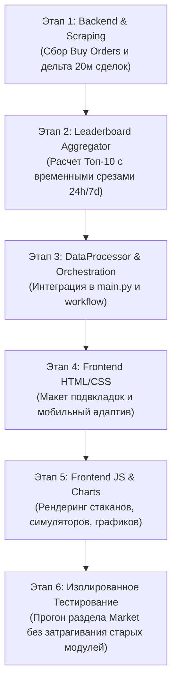

# Техническое Задание (ТЗ) и Архитектурный Проект: Расширение раздела «Рынок» (Wealthrate)

---

## 1. Введение и Цели Проекта

### 1.1. Контекст
В проекте **Wealthrate** (аналитический веб-сервис для экономической геополитической MMO **Warera**, развернутый на Vercel с периодическим сбором данных через GitHub Actions) текущий раздел **Market Depth** («Глубина рынка») отображает исключительно предложения продавцов (Sell Orders). 

### 1.2. Цель
Преобразовать существующий раздел верхнего уровня в единый масштабный раздел **«Market» («Рынок»)**, внутри которого будут располагаться 4 специализированных подраздела:
1. **Sell Depth (Глубина предложений)**: Перенос и полировка текущего функционала (книга ордеров на продажу, симулятор выкупа, топ-3 продавца с бейджами, DOM-визуализация).
2. **Buy Depth (Глубина спроса)**: Зеркальный раздел для всех активных предложений о покупке (Buy Orders): лестница цен с сортировкой по убыванию, топ-3 покупателя, симулятор продажи (дампа в стакан) с подсчетом полученного ₿, DOM-визуализация ликвидности покупателей.
3. **24h Transactions History (Совершенные сделки за 24ч)**: Анализ фактических рыночных сделок за последние 24 часа по каждому товару: объем (Units и PP), потраченные деньги (₿), средневзвешенная цена (VWAP), количество сделок, интерактивный график истории торгов (24ч / 3 дня / 7 дней / Всё время) и раскрывающийся лог последних сделок.
4. **Leaderboard (Лидерборды / Зал славы)**: Сводные таблицы Топ-10 участников для каждого из 3 разделов:
   - **По конкретному товару**: Топ-10 продавцов, покупателей и трейдеров по выбранному товару.
   - **Общий (Global) Топ-10 по всем товарам**: Главный критерий ранжирования — **Production Points (PP)**, что обеспечивает честное взвешивание разнородных товаров (напр. 1 Cocain = 200 PP, 1 Bread = 10 PP, 1 Lead = 1 PP).
   - **Товары без PP (Cases, Scraps: 0 PP)**: Выделены в отдельный переключаемый топ-10 (по единицам Units или сумме ₿), чтобы не искажать PP-рейтинг и не терять ценные непроизводственные активы.

### 1.3. Ключевые требования и ограничения
- **Сохранение мобильного адаптирования**: Верстка на экранах смартфонов (`@media (max-width: 768px)`) должна оставаться идеально читаемой, с компактными числами, горизонтальным скроллом табов и удобными тач-таргетами.
- **Производительность GitHub Actions**: Лимит выполнения workflow — 13 минут. Любые новые сборы данных обязаны использовать батчинг tRPC, инкрементальный сбор и кэширование курсоров.
- **Двухветочная архитектура репозитория**: Ветка `main` содержит код и шаблоны, ветка `data` хранит исторические JSON и сгенерированную директорию `public/`.
- **Действующий API-ключ**: `wae_21b882af32dd75eacfbe29303a5175ccfe961cfbb119641b7a6360e65cbad1e5` (сохранен в заголовке `warera_api_endpoints.json`).

---

## 2. Анализ API Warera (Reverse-Engineering & Probing)

В ходе предварительного тестирования через tRPC эндпоинты Warera были получены ключевые архитектурные выводы:

### 2.1. Получение Buy Orders (Глубина покупки) — 0 дополнительных запросов!
- **Эндпоинт**: `tradingOrder.getPublicOrdersByOwner`
- При запросе ордеров владельца (`userId`, `countryId`, `muId`, `partyId`) сервер Warera возвращает объект вида:
  ```json
  {
    "buyOrders": [
      {
        "_id": "6ad0...",
        "user": "69b2...",
        "itemCode": "bread",
        "quantity": 5000,
        "price": 0.098,
        "offerAt": "2026-10-15T10:00:00.000Z",
        "type": "buy"
      }
    ],
    "sellOrders": [...],
    "totalBuyMoneyInvested": 23840.0,
    "totalSellMoneyExpected": 106943.28
  }
  ```
- **Главный вывод**: Текущий `MarketDepthAnalyzer` уже опрашивает всех участников рынка через `getPublicOrdersByOwner`. Он просто игнорировал ключ `buyOrders`! 
- Интеграция сбора предложений о покупке требует **0 дополнительных сетевых вызовов** при сканировании владельцев!
- Также `tradingOrder.getTopOrders` возвращает и `sellOrders`, и `buyOrders` (лимит до 100).

### 2.2. Получение Сделок (`transaction.getPaginatedTransactions`)
- **Эндпоинт**: `transaction.getPaginatedTransactions`
- **Параметры**:
  ```json
  {
    "limit": 100,
    "transactionType": "trading",
    "cursor": "6ad0... (опционально)",
    "itemCode": "lead (опционально)"
  }
  ```
  *(Примечание: `limit > 100` вызывает ошибку валидации ZodError 400. Максимум — 100).*
- **Поля записи сделки**:
  - `_id`: Уникальный ID транзакции (используется как курсор и для дедупликации).
  - `money`: Сумма сделки в ₿ (float).
  - `quantity`: Количество товара (int).
  - `itemCode`: Код товара (string).
  - `sellerId` / `buyerId`: ID игроков (продавца и покупателя).
  - `sellerCountryId` / `buyerCountryId`: (Опционально) ID государства, если сделка от имени казны.
  - `sellerMuId` / `buyerMuId`: (Опционально) ID военной части.
  - `sellerPartyId` / `buyerPartyId`: (Опционально) ID политической партии.
  - `createdAt`: Время исполнения сделки (ISO 8601).
  - `offerCreatedAt`: Время создания исходного ордера.
- **Расчет цены за единицу**: `unit_price = round(money / quantity, 4)`.

### 2.3. Механика сбора сделок: Последовательная курсорная пагинация (Sequential Cursor Pagination)
- **Важное уточнение по архитектуре запросов**:
  - В отличие от запросов с известными ID (где работает параллельный tRPC batching `batch=1`), в эндпоинте `transaction.getPaginatedTransactions` пагинация осуществляется по параметру `cursor` (ID последней сделки на странице).
  - Поскольку `nextCursor` для следующей страницы возвращается только в ответе текущей, запросы страниц истории сделок **всегда выполняются строго последовательно**.
  - Максимальный размер страницы — `limit: 100`.

### 2.4. Инкрементальная дельта (Delta Sync каждые 20 минут) vs Полный опрос 24ч
- **Дискуссия и анализ частоты опроса (20-минутный крон)**:
  - В игре совершается около 140–150 сделок в минуту (~9,000 сделок в час).
  - За 24 часа накапливается **~140,000–150,000 сделок** (1,500 страниц).
  - **Вывод**: Опрашивать все 24 часа с нуля каждые 20 минут **категорически неэффективно и не имеет смысла** (1,500 запросов заняли бы 2–3 минуты и создали бы паразитную нагрузку на сервер игры).
  - **Архитектурное решение — Инкрементальная дельта по `last_tx_id`**:
    1. При каждом запуске скрипт считывает `last_tx_id` (ID самой свежей обработанной сделки из предыдущего цикла).
    2. Скрипт последовательно запрашивает страницы по 100 сделок от самых новых назад во времени.
    3. Как только в ответе встречается сделка с `_id == last_tx_id`, **пагинация мгновенно останавливается**!
    4. За 20 минут между запусками совершается всего ~2,000–2,500 сделок. Это ровно **20–25 страниц по 100 штук**.
    5. Последовательная загрузка 20–25 страниц занимает всего **1.5–2.5 секунды**!
    6. Новые ~2,000 сделок добавляются в локальное скользящее окно `latest_market_trades.json`, а сделки старше 24 часов (или 7 дней) отсекаются по времени.
    7. **Холодный старт (первый запуск)**: выполняется разово — скрипт выгружает сделки за последние 24 часа (или 7 дней), сохраняет базовый кэш, и далее навсегда переходит на быстрый 2-секундный инкрементальный режим.

### 2.5. Глубина истории в API Warera vs Необходимость собственного хранилища
- **Результаты тестирования глубины API**:
  - Практический зондаж эндпоинта показал, что сервер Warera не имеет жесткого суточного отсечения в базе данных и хранит сделки глубоко назад (успешно выгружены сделки недельной давности и более).
- **Нужно ли хранить свою историю или достаточно того, что возвращает API?**
  - **ОТВЕТ: Свою историю хранить ОБЯЗАТЕЛЬНО, но в виде агрегатов (почасовых и суточных срезов), а не сырых сотен тысяч записей!**
  - **Причины**:
    1. **Предел производительности CI/CD**: 7 дней истории сделок по всей игре — это более 1,000,000 записей (10,000 страниц). Скачивать их "на лету" из API при каждой сборке сайта невозможно физически (это займет 10–15 минут и приведет к таймауту GitHub Actions или бану по rate-limit).
    2. **Защита от чистки БД сервера**: Игровые проекты периодически усекают (truncate) старые транзакции в БД для экономии места. Имея свой компактный исторический архив `history_market_trades.json` (почасовые суммы и VWAP), наш проект навсегда сохранит непрерывную аналитическую историю за недели и месяцы.
    3. **Экономия трафика и вес фронтенда**: 1,000,000 сырых транзакций весят свыше 150 МБ. Хранить их в браузере нельзя. Агрегированные почасовые срезы в `history_market_trades.json` весят всего 200–400 КБ и мгновенно строятся на графиках Chart.js.

### 2.6. Стратегия Первичной Загрузки: 24 часа vs 7 дней (Cold Start Bootstrap)
- **Суть вопроса**: Загружать на старте только последние 24 часа или сразу выгрузить 7 дней?
- **Анализ**:
  - Если мы стартуем с 24 часов, то первые 6 дней вкладка «7 Days» в лидербордах и графиках будет содержать неполные данные и заполнится только к концу недели.
  - Если мы выгрузим 7 дней сразу при первом старте, то пользователи **в первый же день получат полноценные, насыщенные графики и честные Топ-10 за 7 дней**!
  - Спустя 7 дней оба варианта дадут абсолютно одинаковый результат.
- **Решение — Разовый локальный Bootstrap (по аналогии с `bootstrap_known_players.py`)**:
  - В GitHub Actions выкачивать 7 дней (10,000 страниц) рискованно из-за таймаута в 13 минут.
  - Поэтому создается разовый локальный скрипт `scripts/bootstrap_trades.py --days 7`.
  - Мы запускаем его один раз локально на машине разработчика (это занимает ~4-6 минут). Он скачивает историю за 7 дней, формирует начальные файлы `latest_market_trades.json`, `history_market_trades.json` и `daily_trader_stats.json`, и коммитит их в ветку `data`.
  - После этого GitHub Actions подхватывает эти файлы и дальше работает исключительно в 2-секундном инкрементальном режиме!

---

## 3. Архитектура Данных и Структуры JSON

Все файлы данных хранятся в корне репозитория (в ветке `data`).

```
┌────────────────────────────────────────────────────────────────────────┐
│                          DATA STORAGE LAYER                            │
├──────────────────────────────┬─────────────────────────────────────────┤
│ latest_market_depth.json     │ Текущий снимок стаканов Sell & Buy      │
│ history_market_depth.json    │ История объемов стаканов (Sell & Buy)   │
│ latest_market_trades.json    │ Скользящее окно сделок за 24ч + метрики │
│ history_market_trades.json   │ Почасовая история объемов и сумм сделок │
│ daily_trader_stats.json      │ Суточные агрегаты участников для топов  │
│ market_leaderboards.json     │ Предрассчитанные Топ-10 лидерборды      │
│ known_players.json           │ Реестр активных участников рынка        │
└──────────────────────────────┴─────────────────────────────────────────┘
```

### 3.0. `daily_trader_stats.json` (Реестр активности участников для расчета Лидербордов)
Чтобы пересчитывать Топ-10 участников за любой период (**24 часа**, **3 дня**, **7 дней**, **30 дней**) без хранения миллионов сырых транзакций, бэкенд ведет суточный реестр участников:

```json
{
  "last_updated": 1729012345,
  "days": {
    "2026-10-15": {
      "user_69b2...": {
        "type": "user",
        "buy": {
          "money": 15420.5,
          "pp": 142000,
          "units": 14200,
          "by_item": {"bread": {"units": 10000, "money": 1000.0, "pp": 100000}}
        },
        "sell": {
          "money": 32100.0,
          "pp": 300000,
          "units": 30000,
          "by_item": {"steel": {"units": 30000, "money": 32100.0, "pp": 300000}}
        }
      }
    }
  }
}
```
**Как это работает для динамического Топ-10**:
- Когда собирается **Топ-10 за 24 часа**: суммируются показатели игроков за последние 24 часа (или текущие сутки).
- Когда собирается **Топ-10 за 7 дней**: Python берет 7 последних ключей дней (`days`), суммирует показатели каждого участника, сортирует по нужной метрике (потраченные ₿, вырученные ₿, суммарный PP) и получает честный Топ-10 за неделю!
- Файл хранит данные за последние 30-60 дней и весит всего **~400–600 КБ**. Старые дни автоматически удаляются, предотвращая раздувание git-репозитория.

### 3.1. `latest_market_depth.json` (Снимок стаканов ордеров)
Файл расширяется для хранения как предложений на продажу, так и спроса на покупку. Для сохранения обратной совместимости данные группируются по товарам:

```json
{
  "timestamp": 1729012345,
  "data": {
    "lead": {
      "pp_per_unit": 1,
      "sell_depth": {
        "total_units": 1728479,
        "total_pp": 1728479,
        "total_value_btc": 171540.2,
        "top_sellers": [
          {
            "id": "6813b6d546e731854c7ac852",
            "name": "Libya",
            "type": "country",
            "code": "ly",
            "avatar_url": "https://flagcdn.com/w40/ly.png",
            "profile_url": "https://app.warera.io/country/6813b6d546e731854c7ac852",
            "quantity": 190000,
            "share_pct": 11.0,
            "orders": [{"price": 0.102, "quantity": 50000}, {"price": 0.105, "quantity": 140000}]
          }
        ],
        "ladder": [
          {"price": 0.098, "quantity": 411078, "pp": 411078},
          {"price": 0.099, "quantity": 593678, "pp": 593678}
        ]
      },
      "buy_depth": {
        "total_units": 945000,
        "total_pp": 945000,
        "total_money_invested": 91850.5,
        "top_buyers": [
          {
            "id": "6a8f0f0d80a6b04979e2c449",
            "name": "IronCorp",
            "type": "mu",
            "avatar_url": "https://...",
            "profile_url": "https://app.warera.io/mu/6a8f0f0d80a6b04979e2c449",
            "quantity": 350000,
            "share_pct": 37.0,
            "money_invested": 34300.0,
            "orders": [{"price": 0.098, "quantity": 350000}]
          }
        ],
        "ladder": [
          {"price": 0.098, "quantity": 350000, "pp": 350000},
          {"price": 0.097, "quantity": 250000, "pp": 250000},
          {"price": 0.095, "quantity": 345000, "pp": 345000}
        ]
      }
    }
  }
}
```
*(Важно: В `buy_depth.ladder` цены отсортированы **по убыванию** — от наивысшей цены покупки к низшей).*

### 3.2. `latest_market_trades.json` (Метрики и сделки за 24 часа)
```json
{
  "timestamp": 1729012345,
  "last_tx_id": "6ad1048a37aa9538df22c907",
  "window_seconds": 86400,
  "summary": {
    "total_market_money": 2845012.4,
    "total_market_pp": 14250000,
    "total_market_tx": 48200
  },
  "items": {
    "lead": {
      "total_units": 1672300,
      "total_pp": 1672300,
      "total_money": 161205.8,
      "vwap": 0.0964,
      "min_price": 0.092,
      "max_price": 0.105,
      "tx_count": 2455,
      "top_buyers": [
        {"id": "...", "name": "...", "type": "user", "avatar_url": "...", "units": 450000, "money": 43650.0, "share_pct": 26.9}
      ],
      "top_sellers": [
        {"id": "...", "name": "...", "type": "country", "avatar_url": "...", "units": 520000, "money": 50440.0, "share_pct": 31.1}
      ],
      "recent_trades": [
        {
          "id": "6ad1048a...",
          "time": "2026-10-15T16:51:22.935Z",
          "price": 0.097,
          "quantity": 10000,
          "money": 970.0,
          "buyer": {"id": "...", "name": "PlayerA", "type": "user", "avatar_url": "..."},
          "seller": {"id": "...", "name": "Chile", "type": "country", "code": "cl", "avatar_url": "..."}
        }
      ]
    }
  }
}
```

### 3.3. `history_market_trades.json` (История сделок для графиков)
Аналогично `history_market_depth.json`, хранит массив временных меток и почасовые срезы объемов и потраченных денег:
```json
{
  "labels": [1728950400, 1728954000, 1728957600],
  "items": {
    "lead": {
      "hourly_units": [65000, 72000, 68000],
      "hourly_pp": [65000, 72000, 68000],
      "hourly_money": [6370.0, 7056.0, 6664.0],
      "hourly_vwap": [0.098, 0.098, 0.098],
      "hourly_tx": [98, 115, 102]
    }
  }
}
```

### 3.4. `market_leaderboards.json` (Сводные лидерборды с временными срезами)
Предварительно рассчитанный файл со списками лучших участников.
- **Для стаканов (Sell Depth / Buy Depth)**: отображает текущий активный срез рынка (Live Snapshot).
- **Для совершенных сделок (Transactions)**: поддерживает временные срезы (`24h`, `7d`, `30d`), разделяя Топ покупателей и Топ продавцов:

```json
{
  "timestamp": 1729012345,
  "by_item": {
    "lead": {
      "live_depth": {
        "top_sellers": [ /* топ 10 по текущему объему ордеров на продажу (Units/PP) */ ],
        "top_buyers": [ /* топ 10 по текущему объему ордеров на покупку (Units/PP) */ ]
      },
      "trades": {
        "24h": {
          "top_buyers_money": [ /* топ 10 покупателей по потраченным ₿ */ ],
          "top_buyers_volume": [ /* топ 10 покупателей по купленным Units/PP */ ],
          "top_sellers_money": [ /* топ 10 продавцов по вырученным ₿ */ ],
          "top_sellers_volume": [ /* топ 10 продавцов по проданным Units/PP */ ]
        },
        "7d": {
          "top_buyers_money": [ /* топ 10 за 7 дней */ ],
          "top_buyers_volume": [ /* топ 10 за 7 дней */ ],
          "top_sellers_money": [ /* топ 10 за 7 дней */ ],
          "top_sellers_volume": [ /* топ 10 за 7 дней */ ]
        }
      }
    }
  },
  "global_pp": {
    "description": "Рейтинг по всем товарам с PP > 0, нормализованный по суммарным Production Points",
    "live_depth": {
      "top_sellers_pp": [ /* топ 10 продавцов по активным ордерам (суммарный PP) */ ],
      "top_buyers_pp": [ /* топ 10 покупателей по активным ордерам (суммарный PP) */ ]
    },
    "trades": {
      "24h": {
        "top_buyers_money": [ /* топ 10 покупателей по потраченным ₿ за 24ч */ ],
        "top_buyers_pp": [ /* топ 10 покупателей по объему покупок в PP за 24ч */ ],
        "top_sellers_money": [ /* топ 10 продавцов по вырученным ₿ за 24ч */ ],
        "top_sellers_pp": [ /* топ 10 продавцов по объему продаж в PP за 24ч */ ]
      },
      "7d": {
        "top_buyers_money": [ /* топ 10 за 7 дней */ ],
        "top_buyers_pp": [ /* топ 10 за 7 дней */ ],
        "top_sellers_money": [ /* топ 10 за 7 дней */ ],
        "top_sellers_pp": [ /* топ 10 за 7 дней */ ]
      }
    }
  },
  "unmanufactured": {
    "description": "Товары без PP: Scraps, Case 1, Case 2, Wooden Case (ранжирование по Units и ₿)",
    "live_depth": {
      "top_sellers_units": [ /* топ 10 по объему ордеров */ ],
      "top_buyers_units": [ /* топ 10 по объему ордеров */ ]
    },
    "trades": {
      "24h": {
        "top_buyers_money": [ /* топ 10 покупателей по потраченным ₿ */ ],
        "top_buyers_units": [ /* топ 10 покупателей по купленным штукам */ ],
        "top_sellers_money": [ /* топ 10 продавцов по вырученным ₿ */ ],
        "top_sellers_units": [ /* топ 10 продавцов по проданным штукам */ ]
      },
      "7d": {
        "top_buyers_money": [ /* топ 10 за 7 дней */ ],
        "top_buyers_units": [ /* топ 10 за 7 дней */ ],
        "top_sellers_money": [ /* топ 10 за 7 дней */ ],
        "top_sellers_units": [ /* топ 10 за 7 дней */ ]
      }
    }
  }
}
```

---

## 4. Спецификация Backend-модулей (Python)

### 4.1. Обновление `src/market_depth_analyzer.py` -> `MarketOrderBookAnalyzer`
- **Функция**: Опрос всех участников и агрегация одновременно двух стаканов: `sell_depth` и `buy_depth`.
- **Логика**:
  1. При обработке ответа `tradingOrder.getPublicOrdersByOwner`:
     ```python
     sells = data.get("sellOrders", [])
     buys = data.get("buyOrders", [])
     
     # Игрок считается активным участником рынка, если у него есть хотя бы 1 ордер (на продажу ИЛИ на покупку)
     if (sells or buys) and o_type == "user":
         users_with_active_orders.add(owner_id)
     ```
  2. Обработка `buyOrders`:
     - Фильтрация по `itemCode in target_items`.
     - Группировка объемов по цене: `ladder` для покупки сортируется `reverse=True` (от максимальной цены к минимальной).
     - Подсчет общего количества единиц (`total_units`), общих PP (`total_pp = total_units * pp`), и суммарно замороженных денег в ордерах (`total_money_invested = sum(qty * price)`).
     - Вычисление доли и формирование списка `top_buyers` с аватарками и ссылками на профили.
  3. Сохранение `known_players.json`:
     - Игроки с активными ордерами на покупку теперь **гарантированно остаются** в базе игроков, даже если у них нет ордеров на продажу.

### 4.2. Новый модуль: `src/market_trades_analyzer.py`
- **Класс**: `MarketTradesAnalyzer(client: TRPCClient)`
- **Методы**:
  1. `sync_24h_trades(existing_trades_cache: dict | None) -> dict`:
     - Определяет границу времени: `cutoff = datetime.now(timezone.utc) - timedelta(hours=24)`.
     - Загружает ID последней транзакции `last_tx_id` из кэша.
     - Последовательно опрашивает `transaction.getPaginatedTransactions(limit=100, transactionType="trading")` до встречи с `last_tx_id` (~20-25 страниц за 20 минут).
     - Объединяет новые транзакции со старыми, удаляет дубликаты по `_id`, отфильтровывает всё, что старше 24 часов (для живой ленты сделок).
  2. `update_daily_trader_stats(new_trades: list[dict], stats_file: str = "daily_trader_stats.json") -> dict`:
     - Для каждой новой сделки определяет дату `YYYY-MM-DD` по `createdAt`.
     - Накапливает в `daily_trader_stats.json` показатели для `buyerId` и `sellerId`:
       - Сумму потраченных/вырученных ₿
       - Сумму купленных/проданных Production Points (PP) и единиц товара (Units)
       - Распределение по отдельным товарам (`by_item`)
     - Автоматически удаляет дни старше 30-60 дней для постоянного контроля размера файла.
  3. `compute_aggregates(trades: list[dict], entity_metadata: dict) -> dict`:
     - Группирует сделки по `itemCode`.
     - Вычисляет для каждого товара: `total_units`, `total_pp`, `total_money`, `vwap = total_money / total_units`, `min_price`, `max_price`, `tx_count`.
     - Выделяет `top_buyers` и `top_sellers` за последние 24ч.
     - Обогащает данными (имена, флаги, аватары) из кэша участников.
     - Формирует список `recent_trades` (последние 30 сделок по товару).
  4. `update_hourly_history(history: dict, current_hour_bucket: dict) -> dict`:
     - Добавляет почасовой срез в `history_market_trades.json` с лимитом истории (до `MAX_HISTORY_POINTS`).

### 4.3. Новый модуль: `src/market_leaderboard_analyzer.py`
- **Класс**: `MarketLeaderboardAnalyzer`
- **Методы**:
  1. `build_leaderboards(depth_data: dict, daily_stats: dict) -> dict`:
     - **Расчет по временным срезам (`24h`, `7d`, `all`)**:
       - Для каждого периода `T` суммирует дневные срезы участника из `daily_stats` за соответствующие даты (`today` для 24h, последние 7 дат для 7d).
       - **По каждому товару (`by_item`)**:
         - Топ-10 продавцов и покупателей по текущему стакану (Live Depth).
         - Топ-10 покупателей по потраченным ₿ и объему (Units) за период `T`.
         - Топ-10 продавцов по вырученным ₿ и объему (Units) за период `T`.
       - **Общий глобальный лидерборд (`global_pp`)**:
         - Фильтрует товары с `PP > 0`.
         - Суммирует общий объем в Production Points (PP) и ₿.
         - Формирует 4 лидерборда за период `T`:
           - `top_buyers_money` (Top Spenders по сумме ₿)
           - `top_buyers_pp` (Top Buyers по суммарным PP)
           - `top_sellers_money` (Top Earners по вырученным ₿)
           - `top_sellers_pp` (Top Sellers по суммарным PP)
       - **Лидерборд непроизводственных товаров (`unmanufactured`)**:
         - Отбирает только `case1`, `case2`, `woodenCase`, `scraps`.
         - Ранжирует участников по суммарному количеству единиц (`Units`) и потраченным ₿ за период `T`.
     - Сохраняет готовые предобработанные списки в `market_leaderboards.json`.

### 4.4. Обновления в `src/data_processor.py`
Добавить методы для сериализации, десериализации и аппенда:
- `load_latest_market_trades() -> tuple[dict, int]`
- `save_latest_market_trades(data: dict)`
- `load_market_trades_history() -> dict`
- `save_market_trades_history(data: dict)`
- `append_market_trades_snapshot(history: dict, snapshot: dict) -> dict`
- `load_market_leaderboards() -> dict`
- `save_market_leaderboards(data: dict)`

### 4.5. Оркестрация в `main.py`
- Добавить CLI-аргументы:
  - `python main.py --task trades` (сбор только 24h сделок)
  - `python main.py --task leaderboards` (перерасчет лидербордов)
  - `python main.py --task market_depth` (сбор стаканов спроса и предложений)
  - В `--task all` объединить последовательность:
    1. `run_market(client)`
    2. `run_companies(client)`
    3. `run_depth(client)` (собирает Sell Depth + Buy Depth)
    4. `run_trades(client)` (собирает 24h Transactions)
    5. `run_leaderboards()` (генерирует `market_leaderboards.json`)
    6. `run_build()` (собирает `public/index.html`)

---

## 5. UI/UX Спецификация и Дизайн Интерфейса

### 5.1. Информационная Архитектура
В верхнем меню вкладок вкладка `Market Depth` переименовывается в `Market` (`Рынок`).
Внутри контента вкладки `Market` появляется дополнительная панель переключения подразделов (Sub-navigation Pills):

```
┌────────────────────────────────────────────────────────────────────────┐
│                        WEALTHRATE HEADER & TABS                        │
│ [ Profitability ]  [ Company Basing ]  [ Workers ]  [ Market (Active) ]│
└────────────────────────────────────────────────────────────────────────┘
                                    │
                                    ▼
┌────────────────────────────────────────────────────────────────────────┐
│                        MARKET SUB-NAVIGATION                           │
│  [ 🏷️ Sell Depth ]  [ 🛒 Buy Depth ]  [ 📊 24h Trades ]  [ 🏆 Top 10 ]  │
└────────────────────────────────────────────────────────────────────────┘
```

### 5.2. Подраздел 1: Sell Depth (Глубина предложений)
- Полностью соответствует текущему эталону (как на скриншотах пользователя).
- Таблица товаров с сортировкой по названию, объему (PP / Units) и списком Топ-3 продавцов.
- Раскрывающийся аккордеон строки:
  - Карточки Топ-3 продавцов с кликабельными профилями, аватарами, типами сущностей (`[USER]`, `[COUNTRY]`, `[MU]`, `[PARTY]`) и распределением активных лотов по ценам.
  - Лестница книги ордеров (Order Book Ladder): уровни цен по возрастанию (от дешевых к дорогим).
  - Интерактивный **Buyout Simulator**: клик по любой ценовой планке подсвечивает диапазон и показывает:
    `Cost: X.XX ₿` | `Units: Y` | `PP: Z` | `Market Share: W%`.
  - DOM Bar визуализация: горизонтальные полосы объемов (сине-красная/оранжевая палитра предложений).
- График истории глубины предложений: Chart.js с фильтрами периодов (24ч, 3 дня, 7 дней, Всё время) и метрик (Total PP / Total Units).

### 5.3. Подраздел 2: Buy Depth (Глубина спроса)
- Зеркальная структура к Sell Depth, оформленная в приятных бирюзово-зеленых тонах ликвидности покупателей:
- **Заголовки таблицы**: `Product` | `Total Buy Demand (Units / PP / ₿ Invested)` | `Top Buyers`.
- **Карточки Топ-3 покупателей**:
  - Медали #1, #2, #3, аватарка, флаг/логотип, имя со ссылкой на `warera.io`.
  - Суммарный объем спроса в единицах и процентах от общего рынка покупки.
  - Сумма зарезервированных ₿ (`totalBuyMoneyInvested`).
  - Список активных ордеров покупателя (`X units @ Y.YYY ₿`).
- **Лестница спроса (Buy Order Book Ladder)**:
  - Цены отсортированы **по убыванию** (наверху — самая щедрая цена покупки, например 0.101 ₿, затем 0.100 ₿, 0.099 ₿...).
- **Интерактивный Sellout / Dump Simulator (Симулятор продажи в стакан)**:
  - При клике по любому уровню цены рассчитывается: «Что если я немедленно продам товар во все ордера сверху вниз до этой цены?».
  - Показывает:
    - **Received ₿**: Сколько денег игрок мгновенно получит на баланс при продаже.
    - **Units Sold**: Сколько единиц товара будет выкуплено покупателями.
    - **Demand Cleared**: Процент ликвидированного спроса (Market Share %).
- **DOM Bar визуализация**: прогресс-бары глубины с акцентом изумрудного/неоново-зеленого цвета (`#10b981` / `#059669`).
- **График истории спроса**: отслеживание динамики зарезервированных средств в покупке и суммарных PP спроса.

### 5.4. Подраздел 3: 24h Transactions History (Совершенные сделки за 24ч)
- **Сводная статистика в шапке**:
  - Карточки ключевых метрик за 24 часа: 
    - `24h Volume (PP & Units)`
    - `24h Turnover (Суммарный оборот в ₿)`
    - `Total Trades Count (Число сделок)`
- **Таблица товаров (24h Market Summary)**:
  - Колонки: `Product` | `24h Volume (PP / Units)` | `24h Money (₿)` | `VWAP (Средняя цена ₿)` | `Price Range (Min - Max)` | `Trades Count`.
  - Индикаторы динамики цены или объема.
- **Интерактивный лог последних сделок (Collapsible Trade Drawer)**:
  - При клике на строку товара раскрывается лента последних сделок (Live Trade Feed):
    - Время (напр. `14:22:05` / `2m ago`).
    - Цена сделки (₿) и количество единиц.
    - Сумма сделки (₿).
    - Продавец (аватар + имя + тип).
    - Покупатель (аватар + имя + тип).
- **Интерактивный график Chart.js (24h Trade Dynamics)**:
  - Переключатели периодов: `24 Hours`, `3 Days`, `7 Days`, `All Time`.
  - Переключатели метрик: `Volume (PP)`, `Volume (Units)`, `Money Spent (₿)`, `Trade Count`.
  - Возможность изолировать товар через мульти-селект или клик по легенде.

### 5.5. Подраздел 4: Leaderboard (Лидерборды / Зал славы)
- **Панель управления фильтрами**:
  1. **Селектор режима**:
     - `По конкретному товару` (выпадающий список или лента иконок товаров).
     - `Общий Топ (Global)` (сводный рейтинг).
  2. **Вкладки лидерборда**:
     - **По текущим стаканам (Live Snapshot)**:
       - `🏷️ Top Sellers (Order Book)` — крупнейшие активные продавцы.
       - `🛒 Top Buyers (Order Book)` — крупнейшие активные покупатели.
     - **По совершенным сделкам (Realized Trades)**:
       - `💰 Top Spenders` — топ покупателей по потраченным ₿.
       - `📦 Top Buyer Volume` — топ покупателей по объему купленного (PP / Units).
       - `💵 Top Earners` — топ продавцов по вырученным ₿.
       - `🏭 Top Seller Volume` — топ продавцов по объему проданного (PP / Units).
  3. **Временной фильтр для сделок (Time Windows)**:
     - Для рейтингов по сделкам доступен переключатель временных срезов:
       `[ 24 Hours ] [ 3 Days ] [ 7 Days ] [ All Time ]`.
  4. **Переключатель непроизводственных товаров (0 PP)**:
     - При выборе «Общий Топ» активен переключатель:
       `[ 🏭 Производство (Рейтинг по PP) ]` | `[ 📦 Кейсы и Металлолом (0 PP: по штукам и ₿) ]`.
- **Отображение строк лидерборда**:
  - Места #1, #2, #3 с золотым, серебряным и бронзовым оформлением (кубки/медали).
  - Места #4-#10 со стильными аккуратными бейджами позиций.
  - Аватар сущности (для игрока — аватар, для страны — флаг `flagcdn.com`, для партии/военной части — их логотипы).
  - Название сущности со ссылкой на игровой профиль Warera.
  - Бейдж типа сущности: `USER`, `COUNTRY`, `MU`, `PARTY`.
  - Основной числовой показатель: PP, Units или ₿ с компактным и точным форматированием (`1.45M PP (1,450,000)`).
  - Процентная доля от общего объема рынка.

---

## 6. Мобильная Адаптивность (`@media (max-width: 768px)`)

Чтобы гарантировать непревзойденный UX на мобильных устройствах:

1. **Sub-navigation Pills (Горизонтальный скролл)**:
   ```css
   .market-subtabs-nav {
       display: flex;
       gap: 8px;
       overflow-x: auto;
       white-space: nowrap;
       -webkit-overflow-scrolling: touch;
       scrollbar-width: none;
       padding-bottom: 6px;
   }
   .market-subtabs-nav::-webkit-scrollbar {
       display: none;
   }
   ```
2. **Адаптивные тексты в шапках таблиц**:
   - Использование классов `<span class="desktop-text">...</span>` и `<span class="mobile-text">...</span>` для сокращения названий колонок на смартфонах (напр. «Объем (PP)» вместо «Суммарный объем в очках производства»).
3. **Компактные бейджи и карточки Топ-3**:
   - На экранах `<= 768px` карточки Топ-3 покупателей/продавцов перестраиваются из сетки `grid-template-columns: repeat(3, 1fr)` в вертикальный стек `flex-direction: column` с минималистичным отступом.
4. **Тач-таргеты и симуляторы**:
   - Строки лестницы цен (Price Ladder) имеют минимальную высоту 40px и увеличенные области клика, что предотвращает случайные нажатия на мобильных устройствах.
   - Плашка симулятора выкупа/дампа фиксируется в нижней части карточки или плавно прилипает (sticky) при скролле стакана.

---

## 7. Пошаговый План Реализации (Roadmap для Следующего ИИ)

Следующий разработчик (или AI-агент) должен выполнять внедрение строго по этапам:



### Этап 1: Backend Data Scrapers
- [ ] Модифицировать `src/market_depth_analyzer.py`:
  - В цикле по `responses` извлекать `buys = data.get("buyOrders", [])`.
  - Формировать объект `buy_depth` с лестницей цен (сортировка по убыванию `reverse=True`), общими единицами, PP, зарезервированными деньгами и списком `top_buyers`.
  - Обновить проверку `users_with_active_orders`: добавлять игрока, если `sells or buys`.
  - В методе обнаружения владельцев проверять также Топ-100 ордеров на покупку (`tradingOrder.getTopOrders` возвращает и `buyOrders`).
- [ ] Создать `src/market_trades_analyzer.py`:
  - Реализовать быструю дельта-выгрузку сделок через последовательную курсорную пагинацию `transaction.getPaginatedTransactions` до остановки по `last_tx_id` (~20 страниц за 20 минут).
  - Добавить расчет VWAP, min/max цен, 24h объемов и сумм.
  - Реализовать сохранение скользящего буфера в `latest_market_trades.json`, почасовых срезов в `history_market_trades.json` и ведение суточного реестра участников в `daily_trader_stats.json`.
- [ ] Создать разовый скрипт начального наполнения `scripts/bootstrap_trades.py --days 7`:
  - Запускается 1 раз локально разработчиком для наполнения базы за 7 дней, чтобы сразу получить полные графики и 7-дневные лидерборды в день запуска.

### Этап 2: Leaderboard Aggregator
- [ ] Создать `src/market_leaderboard_analyzer.py`:
  - Сформировать рейтинги Топ-10 по каждому товару:
    - Продавцы и Покупатели по стаканам (Live Depth).
    - Топ покупателей (по потраченным ₿ и по штукам) и продавцов (по вырученным ₿ и по штукам) по сделкам.
  - Реализовать расчет временных срезов на основе `daily_trader_stats.json` (`24h`, `7d`, `all`).
  - Сформировать общий рейтинг по PP для товаров с `PP > 0`.
  - Сформировать отдельный рейтинг для товаров с `0 PP` (`case1`, `case2`, `woodenCase`, `scraps`) по штукам и деньгам.
  - Сохранять результат в `market_leaderboards.json`.

### Этап 3: Data Processor & Orchestration
- [ ] Добавить в `src/data_processor.py` методы загрузки и сохранения для сделок и лидербордов.
- [ ] В `src/report_generator.py` передавать новые JSON-структуры в шаблон:
  - `buy_depth_data_json`, `trades_data_json`, `trades_history_json`, `leaderboard_data_json`.
- [ ] В `main.py` добавить вызовы сбора и генерации в функции `run_depth`, `run_trades`, `run_build`.

### Этап 4: Шаблонизация и Верстка (HTML/CSS)
- [ ] В `templates/index.html` переименовать вкладку верхнего уровня `Market Depth` -> `Market`.
- [ ] Разместить блок суб-навигации:
  ```html
  <div class="market-subnav-container">
      <button class="market-subtab-btn active" onclick="switchMarketSubtab('sell_depth', this)">🏷️ Sell Depth</button>
      <button class="market-subtab-btn" onclick="switchMarketSubtab('buy_depth', this)">🛒 Buy Depth</button>
      <button class="market-subtab-btn" onclick="switchMarketSubtab('trades_24h', this)">📊 24h Trades</button>
      <button class="market-subtab-btn" onclick="switchMarketSubtab('leaderboards', this)">🏆 Leaderboard</button>
  </div>
  ```
- [ ] Добавить контейнеры для 4 подразделов (`#market_sub_sell`, `#market_sub_buy`, `#market_sub_trades`, `#market_sub_leaderboard`).
- [ ] Встроить CSS-стили для мобильного адаптива, DOM-баров и таблиц лидерборда.

### Этап 5: Frontend JavaScript & Charts
- [ ] Реализовать функцию `renderBuyDepthTable()`: генерация лестницы спроса, карточек покупателей и симулятора продажи в стакан.
- [ ] Реализовать функцию `renderTradesTable()`: генерация сводки за 24 часа, VWAP, карточек и раскрывающегося лога сделок.
- [ ] Настроить график Chart.js для истории торгов (`#tradesChart`): переключение 24ч / 3д / 7д / Всё время, метрики PP / Units / ₿ Spent.
- [ ] Реализовать логику интерактивного переключения лидербордов: переключение между товарами, Global PP, кейсами/скрапом, а также временными срезами (24h / 7d).

### Этап 6: Изолированное Тестирование и Сдача
> [!IMPORTANT]
> **Принцип изоляции**: Существующие разделы (`Profitability`, `Company Basing`, `Workers`) **НЕ модифицируются и НЕ перезапускаются**. Они полностью стабильны и остаются нетронутыми.
- [ ] Выполнить тестовый прогон исключительно новых задач рынка:
  `python main.py --task market_depth && python main.py --task trades && python main.py --task leaderboards && python main.py --task build`
- [ ] Проверить время выполнения инкрементального сбора сделок (строго до 2-3 секунд).
- [ ] Проверить рендер нового раздела `Market` и всех 4 вкладок в сгенерированном `public/index.html`.
- [ ] Проверить мобильный вид (эмуляция ширины 375–414px) — убедиться, что ни один элемент старых или новых вкладок не ломает горизонтальную верстку.

---

## 8. Памятка по Конфигурации и Ключам

| Параметр | Значение | Описание |
|---|---|---|
| **Base API URL** | `https://api2.warera.io/trpc` | Базовый tRPC шлюз Warera |
| **Тестовый API-ключ** | `wae_21b882af32dd75eacfbe29303a5175ccfe961cfbb119641b7a6360e65cbad1e5` | Активный рабочий ключ, зафиксирован в `warera_api_endpoints.json` |
| **Лимит пагинации tRPC** | `100` | Максимальный лимит для `transaction.getPaginatedTransactions` и `tradingOrder.getTopOrders` |
| **Батчинг tRPC** | `batch=1` (20-30 вызовов) | Позволяет выгружать тысячи записей за доли секунды |
| **Переменные окружения** | `WEALTHRATE1`, `WEALTHRATE2`, `WEALTHRATE3` | Ключи ротации для GitHub Actions |
